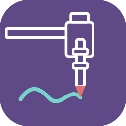

<p align="center">
  
</p>

<h1 align="center">PenPilot</h1>

A standalone desktop app for the **AxiDraw V3** pen plotter on **Mac and Windows**.
You install one thing and it works: no Inkscape, Node.js, Python or drivers to set up.

PenPilot is built on [saxi](https://github.com/alexrudd2/saxi) (AGPL-3.0), which
handles the plotter, motion planning, preview and plotting. Saxi's own README is
kept in [`docs/saxi-README.md`](docs/saxi-README.md). The full plan for PenPilot
is in [`PLAN.md`](PLAN.md).


## Updates

PenPilot checks for a new version when it opens and every few hours, from the
**public** releases page [Ava-AgentOne/penpilot-releases](https://github.com/Ava-AgentOne/penpilot-releases)
(installers, each version's source code, and `latest.json`; this working repo stays private).
When there's a newer one it shows **"PenPilot X is ready"** with what's new, and **Update now**
downloads it, checks its SHA-256 and installs it, then PenPilot closes and opens again
(`desktop/app/updater.cjs`). **Help → Check for updates…** checks straight away.

- **Mac:** PenPilot swaps its own app for the new one (it must be in Applications, not run
  from the disk image). Apple's own updater isn't used: it needs a paid signature.
- **Windows:** the installed version runs the new installer silently and reopens; the
  portable .exe replaces itself.

**Publishing a release**:
1. Set the version in `desktop/app/package.json`, write `docs/release-notes/<version>.md`
   (its "- " lines are the notes in the update message), commit, and push a tag `v<version>`.
   The tag makes GitHub Actions build the Windows installers.
2. `npm run dist:mac` (dmg + the update zip), and download the Windows build into `release/windows/`.
3. `node desktop/scripts/publish-release.mjs <version> docs/release-notes/<version>.md`:
   uploads the installers, the source zip of that tag, and `latest.json`.

## What works now (build steps 1–7)

**Final polish (step 7):**
- **App icon:** a plotter's pen carriage in white lines on purple, drawing a teal line (made by `desktop/scripts/make-icons.cjs`).
- **Welcome guide** the first time PenPilot opens: home corner and paper, your pen, your page, Frame then Plot, saving. **Help** (under the PenPilot name) opens it again.
- **Double-click a .penpilot project** in Finder or Explorer to open it. If PenPilot is already open, the project opens there (it asks first if the page has unsaved changes). Only one PenPilot runs at a time, so two copies never fight over the plotter.
- **Plain wording:** the old "more" settings are now **Advanced**, in plain words (line clean-up, movement, pen timing, plotter model). **reset these settings** no longer touches the paper, the plotter model or Reverse pen direction. **Motors off** lets you move the carriage by hand.
- **A tidier side panel:**
  - New, Open, Save, Save as and Export SVG are in the **File menu** (menu bar), with ⌘N / ⌘O / ⌘S / ⇧⌘S / ⌘E (Ctrl on Windows). **Help** in the menu bar has the welcome guide and the Plotter check.
  - **Pen**, **Paper**, **Drawings** and **Advanced** fold up, showing a one-line summary when closed (e.g. "A4 · landscape · 20 mm"). PenPilot remembers which are open.
  - The plotter status is one small button ("● Plotter ready"); click it for the Plotter check.
  - Pen: **Raise**, **Lower** and **Test square** in one row; heights, speed, width and colour under **Edit pen settings**; **+** adds a pen.
  - Drawings: one **+ Add** menu (drawing or photo, text, rectangle, circle, border). A drawing's **Pen**, **Fill** and **Size and position** fold up too.
  - Plot: **Frame** and **Plot** side by side; **Pause** and **Stop** appear only while plotting.
- **Workspace toolbar** at the top of the page: **Undo** / **Redo** (⌘Z / ⇧⌘Z, Ctrl+Z / Ctrl+Y on Windows; also in the Edit menu), **Save**, **Duplicate** the selected drawing (⌘D), **Remove** it, **zoom** out / in with the zoom % (click it to fit), **Fit the page** (⌘0), and **show/hide the grey pen-up moves**. Undo covers every change on the page (up to 100 steps); quick repeats like dragging a slider or nudging count as one step. While typing in a text box, Undo undoes the typing. New and Open start a fresh undo history.
- **Zoom:** pinch on the trackpad (or ⌘ / Ctrl + scroll wheel) to zoom towards the pointer; ⌘+ / ⌘− zoom the page (View menu). When zoomed in, scroll to move around; dragging, resizing and the corner dot work at any zoom.
- **Choose what to plot:** each drawing in the list has a **tick**. Unticked drawings stay on the page (faint) but Plot and Frame leave them out, and the plot time only counts what will be drawn. After a plot finishes, **Untick them** unticks what was just drawn, so you can add text (or anything) and plot only the new part, lined up with what's already on the paper. Ticks are saved with the project. (This replaces saxi's "drawings to plot" list, which reset itself whenever anything changed.)

**Projects and shapes (step 6, second half):**
- **Save / Save as… / Open… / New** at the top of the panel (⌘S / Ctrl+S saves, ⌘O / Ctrl+O opens). A **.penpilot** project keeps the whole page: every drawing with its lines, place, size, fill and pen, photos with their pictures and style, text with its settings, the paper and margins, and the pens used. Opening it brings the page back exactly, without redrawing (so a random photo style looks the same). Pens the computer doesn't have yet come with the project. You can also drag a .penpilot file onto the window.
- The project's name shows under the buttons, with **changes not saved** when you've edited since. Closing PenPilot with unsaved changes asks first.
- **Export SVG…** saves the page's lines (hatching included) as an SVG in mm: one layer per pen, in plotting order, in the pen's colour and line width. Inkscape shows the layers by pen name.
- **Add shape: Rectangle, Circle, Border.** A border is a double line just inside the page margins. Shapes stretch freely (the corner dot, or width and height separately). Each has **corner radius** (rectangles), **lines** (1 to 10, each inside the last) and **gap between lines**. Like any closed shape, they can be hatch-filled.

**Pens (step 6, first half):**
- **Your pens, saved:** each pen has a name, an on-screen colour, its own **up and down heights**, **drawing speed** and **line width**. Pick one from the list, or press **New pen**. Your old pen settings became the first pen, "My pen".
- **Raise pen / Lower pen** use the chosen pen's heights. After Lower pen, changing the down height moves the pen as you type, so you can set it until the tip just touches.
- **Test square:** draws a 10 mm square in the paper's corner margin by the home position, half filled with lines one pen-width apart. The filled half should look solid if the line width is right. Each new test moves along the edge so they don't overlap.
- **Several pens on one page:** every drawing has a pen (new drawings get the pen chosen in the Pen section). Click the **coloured dot** beside a drawing in the list to pick its pen. PenPilot plots one pen's drawings, parks the carriage in its home corner, chimes, bounces the Dock icon and shows **Put in ● Red gel pen**. Swap the pen and press **Continue**. Each pen draws with its own heights and speed. The plot section lists the pens in order, and **▲** moves a pen earlier.
- **Split by colour:** an SVG with several line colours offers **Split into one drawing per colour**. Each colour becomes its own drawing in the same place, given the pen of the same colour if you have one.
- **Continue after a stop:** **Stop** now always lifts the pen and drives back to the home corner. Afterwards PenPilot shows **Stopped after 152 of 480 lines** with a slider to pick the line to **continue from** (step back if the pen ran dry; finished lines show in teal). If that line needs a different pen, it asks for it first. **Pause** waits with the pen lifted, so you can swap a pen; the pen is lifted again before it carries on.
- **Real line width preview:** lines show on screen as wide as each pen draws them, so hatching looks as dark as it will on paper (**advanced → Show lines at the pen's real width** to switch back to thin lines).

**Hatch fill (step 5):**
- Any drawing with **closed shapes** (a traced outline, an SVG of filled shapes, letters) gets a **fill** choice: **Hatch: lines**, **Hatch: cross-hatch** or **Concentric** (shrinking outlines). Shapes look solid on paper.
- **Line spacing** (set it to about your pen's line width for a solid look), **angle**, and **Draw the outlines too**. Holes (the inside of an "o") stay empty.
- The hatching **zig-zags** through each shape with the pen down, instead of lifting at every line. It's faster and leaves no dots at the line ends.
- **Filled letters:** the traced fonts (Arabic and handwriting) have a **One line / Filled** switch. Filled traces each letter's outline and hatches it, so the text looks like the font on screen.
- The fill-shapes warning on an SVG now also offers **Fill them with hatching**.

**Single-line text (step 4):**
- **Add text** in **41 single-stroke fonts** (Windell Oskay's Hershey and EMS collection, 22 of them handwriting and script): each letter is one pen stroke, with no hollow outlines.
- **Arabic** (Alkalami, Noto Naskh, Amiri, Lateef, Reem Kufi, Tajawal) and **more handwriting** (Caveat, Dancing Script, Kalam, Homemade Apple, Indie Flower), written as **traced fonts**. PenPilot draws the text in the font, so Arabic joins and runs right-to-left correctly, then traces one pen line through each letter. Letter dots become small pen circles.
- Several lines, **letter size** (capital height in mm, measured from each font's real letters), **letter spacing**, **line spacing**, **left / centre / right**. Move, resize and turn it like any drawing; resizing changes the letter size.
- Letters a font can't write (e.g. Arabic) are named in a plain message.

**Tracing and photos (step 3):**
- Add an **image** (JPG, PNG, WebP, GIF) and it is **traced** into vector lines. **Trace: centre lines** is the default: one pen stroke down the middle of every line of a drawing, drawn in a single pass. **Trace: outlines** traces the edges of every dark shape, like a typical "image trace", so the pen draws both sides of each line. Sliders: Threshold, Inverted, Blur, Remove specks, Simplify, Smoothing, Detail.
- An **SVG made only of filled shapes** (typical image-trace output) gets a warning that the pen would draw every line twice, plus a **Trace centre lines instead** button. It converts the drawing in place, at the same size and position.
- Or turn a **photo** into pen-line art with one of **23 styles** from [Plotterfun](https://github.com/mitxela/plotterfun). Styles include Squiggle, Spiral (one continuous line), Stipples, Linedraw, Halftone, Waves, Peano and Mosaic.
- Each style's own sliders, plus **Detail**, **Brightness**, **Contrast** and **Inverted**. It redraws a moment after you stop moving a slider, and shows its progress.
- The photo shows faintly behind its lines while selected. Move, resize, turn and Frame work as for any drawing.

**Page editor (step 2):**
- **Several drawings on one page.** Add SVGs with **Add drawing…** or drag them in (several at once).
- **Move** by dragging and **resize** with the corner dot (proportions kept). Also: exact x / y / width / height in mm, **Turn 90°**, **Centre**, **Fit page**, arrow keys to nudge (Shift = 10 mm), Delete to remove. Drawings snap to the centre of the page.
- **Portrait / Landscape** switch. When the page doesn't fit the V3 as shown (A4 portrait is 297 mm tall, the V3 reaches 218 mm), PenPilot turns the plot and tells you to put the sheet in sideways, top of the page on the left.
- **Reach warning:** paper bigger than 300 × 218 mm gets a striped "can't reach" area. Drawings sticking into it, or off the sheet, are flagged and cropped.
- **Frame:** with the pen lifted, the plotter traces the rectangle the drawings cover, once or round and round until you press Stop frame.
- **While plotting,** lines already drawn turn teal on screen and a red cross follows the pen.
- **Save your own paper sizes** (Custom → name → Save size). They appear as ★ in the paper list.
- Each drawing is a layer, so you can choose which drawings to plot.

**Foundation (step 1):**

- **One install** on Mac (`.dmg`) or Windows (installer, or a portable `.exe` that runs without installing).
- **Plotter check** when the app opens, and again whenever the plotter is plugged in or unplugged. In plain words it tells you if:
  - the plotter isn't found (cable, port, a charge-only cable);
  - Windows sees the plotter but has no driver (Windows 8 and older). An **Install driver** button fixes this;
  - the plotter doesn't answer (another program has it open);
  - the firmware is older than 2.5.3. On Windows, **Update firmware** opens the official updater (firmware 3.1.7);
  - the motor power adapter isn't plugged in.
- **Reverse pen direction** tick-box for pen-lift motors that move the other way (common on AxiDraw-compatible clones). Pause, cancel and the pen lift before the first move all respect it.
- A clear message when a file can't be plotted (a photo, an SVG with no lines), instead of hanging on "Loading file...".
- Everything saxi already does: drop in an SVG, choose paper (A4 landscape by default) and margins, preview with time estimate, plot, pause, resume and stop.

## Installing

### Mac (Apple Silicon)

1. Open `PenPilot-<version>-mac-arm64.dmg` and drag **PenPilot** into **Applications**.
2. **First open only:** PenPilot isn't signed with a paid Apple certificate, so macOS blocks it the first time it comes from a download or another computer:
   - Double-click PenPilot. When macOS says it can't check it, press **Done**.
   - Open **System Settings → Privacy & Security**, scroll down, and press **Open Anyway** next to "PenPilot was blocked". Enter your password.
   - After that it opens normally. If you built it on this Mac yourself, you won't see the warning at all.

### Windows 10 / 11

1. Run `PenPilot-Setup-<version>.exe`, or use `PenPilot-Portable-<version>.exe` from anywhere without installing.
2. **First run only:** Windows SmartScreen may say "Windows protected your PC". Press **More info → Run anyway**. This appears because the app isn't signed with a paid certificate.
3. No driver is needed on Windows 10/11. On Windows 8 or older, PenPilot offers **Install driver** on the Plotter check screen. Windows asks for permission once.

## Building

```bash
npm ci
npm run desktop     # run the app from source
npm run dist:mac    # Mac installer → release/PenPilot-<version>-mac-arm64.dmg
```

The **Windows** installer and portable `.exe` are built on GitHub's Windows machines:

```bash
gh workflow run desktop.yml
gh run download --name PenPilot-windows --dir release/windows
```

Pushing a tag like `v0.1.0` builds them too.

### How it fits together

| Folder | What's in it |
|---|---|
| `src/` | saxi's UI, plotter driver and motion planner. PenPilot additions are in `src/penpilot/`. |
| `desktop/app/` | The desktop shell (Electron): window, private `app://` page loader, automatic plotter selection, Windows helpers. `desktop/app/ui/` is generated by `npm run desktop:ui`. |
| `desktop/windows-extras/` | Official EiBotBoard USB driver and firmware updater (Windows build only). See its `SOURCE.md`. |
| `electron-builder.yml` | Installer settings for both systems. |
| `samples/penpilot-test.svg` | A small test drawing (about 45 seconds). |

How PenPilot reaches the plotter (only ever the AxiDraw's board, USB `04D8:FD92`,
matched in `desktop/app/serial-match.cjs`):

- **macOS: direct USB serial** from the desktop shell (`desktop/app/native-serial.cjs`,
  Node `serialport` with its prebuilt N-API driver), streamed to the UI over IPC
  (`src/penpilot/native-port.ts`). Chromium's Web Serial isn't used on the Mac:
  - The EiBotBoard reports no USB serial number, so Chromium never pre-approves it.
  - Its port picker (and even its plug/unplug events) start macOS's Bluetooth stack on
    the main thread. That froze the app until a Bluetooth permission prompt was
    answered, once for every new build.
- **Windows: Web Serial** inside Electron, with the board pre-approved by its Windows
  device ID, so nothing appears on screen.

## Licence

AGPL-3.0, the same as saxi. See [`LICENSE`](LICENSE) and [`NOTICE.md`](NOTICE.md) for all the
parts PenPilot is built from. AxiDraw is a trademark of Evil Mad Scientist Laboratories.
PenPilot isn't made by or affiliated with them.
